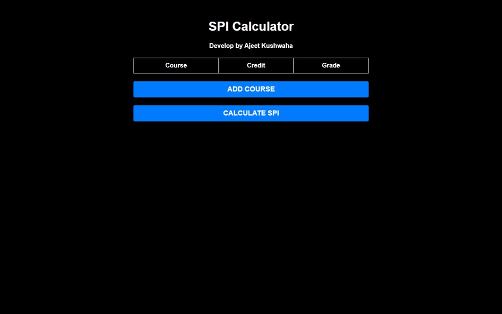

# SPI Calculator

A single-page semester performance index calculator: add courses with credits and grades, get the SPI instantly.

**[Open the live site](https://ajeet-iitk.github.io/spi/)**

## What it does

Type a course, its credit value and the grade earned, then press **Calculate SPI**. Grades are weighted by credits, so a 4-credit A counts more than a 2-credit B - exactly how the index works at IIT Kanpur. A companion page does the cumulative version.

## Features

- Add-course rows generated on demand, as many as the semester needs
- Credit-weighted SPI for the current list
- Separate CPI page for cumulative figures
- No build step, no framework, no dependencies

## Run locally

Open `index.html` in a browser, or use the hosted copy:

<https://ajeet-iitk.github.io/spi/>

## Files

| File | Purpose |
| --- | --- |
| `index.html` | SPI calculator |
| `CPI.html` | CPI calculator |
| `cpi_style.css` | Shared styling |

---

Part of [my collection of small projects](https://github.com/Ajeet-iitk).
